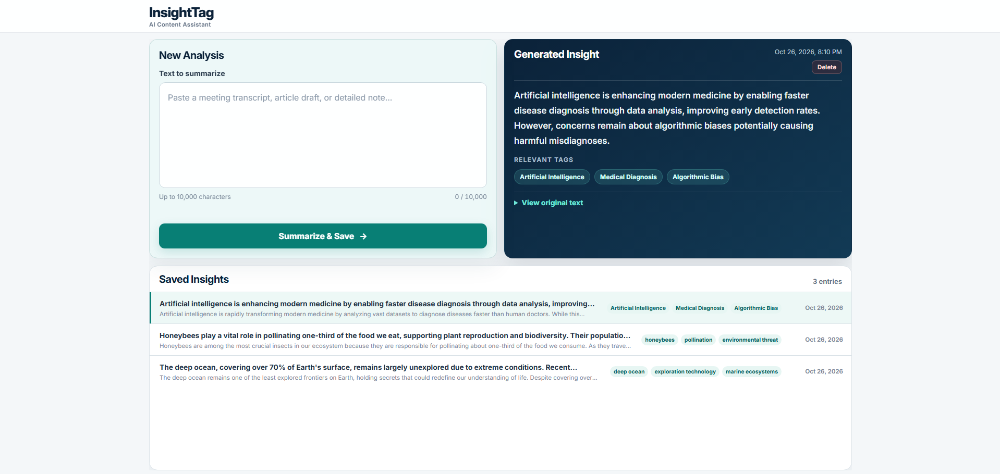

# InsightTag

InsightTag turns notes, articles, and meeting transcripts into concise AI summaries with exactly three relevant tags. React and FastAPI provide the workflow, while SQLite preserves validated results.



## Run locally

### Prerequisites and configuration

Before running InsightTag, ensure the following are installed:

- **Python:** 3.10 or newer
- **Node.js:** 22.22.2+ (Node.js 22.x) or 24.15.0+ (Node.js 24.x)
- **OpenRouter API Key:** Required to generate new AI summaries and tags. The backend can start and retrieve saved entries without a valid key, but `POST /entries` returns HTTP 503 until a valid key is configured.

Verify your installation:

```bash
python --version
node --version
npm --version
```

**Note:** InsightTag's frontend uses Vite, Vitest, and jsdom. Older Node.js versions may not satisfy all dependencies defined in `package-lock.json`. Use a supported version before running `npm ci`.

From the repository root, create your environment configuration as described below:

**Windows PowerShell**

```powershell
Copy-Item .env.example .env
```

**macOS / Linux**

```bash
cp .env.example .env
```

The recommended configuration uses the fixed, live-verified model:

```dotenv
OPENROUTER_API_KEY=your-real-openrouter-api-key
LLM_MODEL=openai/gpt-4.1-mini
```

Evaluators may instead use the live-tested free router:

```dotenv
OPENROUTER_API_KEY=your-real-openrouter-api-key
LLM_MODEL=openrouter/free
```

Both require a valid key and passed live checks. GPT-4.1 Mini uses paid credits and remains recommended. The free router needs no paid model credits, but availability and rate limits vary. Credentials stay backend-only; `.env` is Git-ignored.

### Backend

**Windows PowerShell**

```powershell
cd backend
python -m venv .venv
.\.venv\Scripts\python.exe -m pip install -r requirements-dev.txt
.\.venv\Scripts\python.exe -m uvicorn app.main:app --reload
```

**macOS / Linux**

```bash
cd backend
python3 -m venv .venv
./.venv/bin/python -m pip install -r requirements-dev.txt
./.venv/bin/python -m uvicorn app.main:app --reload
```

FastAPI runs at `http://127.0.0.1:8000`, with Swagger UI at `/docs`. SQLite initializes at `backend/data/insighttag.db` and persists across restarts.

### Frontend

In a second terminal:

```bash
cd frontend
npm ci
npm run dev
```

Open the Vite URL, normally `http://localhost:5173`. Its `/entries` proxy keeps credentials out of the browser.

### API behavior

- `POST /entries` validates text and AI output, persists the result, and returns HTTP 201.
- `GET /entries?page=1&page_size=10` returns newest-first server-side pagination; `GET /entries/{entry_id}` returns one record.
- `DELETE /entries/{entry_id}` permanently removes a confirmed record and returns HTTP 204.
- Application failures use `{ "error": { "code": "...", "message": "..." } }`; request validation retains FastAPI's HTTP 422 field details.


## Verify

Run backend tests from `backend`:

```powershell
# Windows
.\.venv\Scripts\python.exe -m pytest -q
```

```bash
# macOS / Linux
./.venv/bin/python -m pytest -q
```

Run frontend checks from `frontend`:

**Windows / macOS:**

```bash
npm test
npx playwright install chromium
npm run test:e2e
npm run build
```

**Linux:**

```bash
npm test
npx playwright install --with-deps chromium
npm run test:e2e
npm run build
```

Current results: **44 automated tests passed**: 25 pytest, 13 Vitest/React Testing Library, and 6 Playwright Chromium; the production build succeeded. Tests mock external boundaries.

Successful live OpenRouter checks of `openai/gpt-4.1-mini` and `openrouter/free` were recorded on October 26, 2026. Model availability, pricing, and rate limits may change.

See the [verification report](docs/verification.md) for historical results and limitations.

## Engineering decisions

### 1. Architecture

1. React submits user text to FastAPI through `POST /entries`.
2. Pydantic normalizes and validates input before calling OpenRouter.
3. The backend requests structured JSON output over HTTPS.
4. Pydantic independently requires a nonblank summary and exactly three distinct tags.
5. The LLM call completes before any database write; only validated results are committed to SQLite with the original text and timestamp.
6. React retrieves paginated records and details while rejecting stale asynchronous responses.
7. Confirmed deletion removes one record and refreshes the last valid page.

### 2. AI choice

The fixed `openai/gpt-4.1-mini` model offers consistent routing, structured JSON Schema output, and low per-request cost.
`openrouter/free` is a live-tested alternative for evaluators, but availability and rate limits vary.
OpenRouter keeps model access behind one backend integration without exposing credentials to React.
Pydantic validates every response independently before persistence.

### 3. Reliability

OpenRouter requests use a 5-second connection timeout and a 15-second response timeout; failures return sanitized, machine-readable errors with appropriate HTTP statuses.
Malformed JSON, blank summaries, and invalid or duplicate tags are rejected.
Failed AI generation creates no database record, while the frontend reports loading and failure states.
Automatic retries are intentionally omitted because entry creation is not idempotent.

### 4. Privacy

Submitted text is sent to OpenRouter and may be processed by its selected model provider; the API key remains backend-only.
Original text and generated content are stored in local SQLite, while logs omit user text and sensitive provider messages.
Users should not submit PII, financial records, account details, or credentials to this prototype.
Production use requires approved provider terms, redaction, access controls, and retention policies.

### 5. Production next steps

- Add authentication, entry ownership, redaction, encryption, and retention/deletion controls.
- Introduce bounded retries, idempotency protection, and monitoring for latency, failures, and token costs.
- Run automated tests in CI, establish a small summary-and-tag quality evaluation dataset, and evaluate PostgreSQL with migrations when concurrent usage warrants it.

### 6. AI coding tools

OpenAI Codex assisted with requirement analysis, implementation, tests, UI refinement, and documentation.
Generated changes were reviewed for secret handling, prompt boundaries, parameterized SQL, validation, and failure behavior.
Automated backend, component, and browser tests validate the API boundary, persistence, and core interactions.
Manual browser checks and genuine OpenRouter requests provided separate integration evidence.
